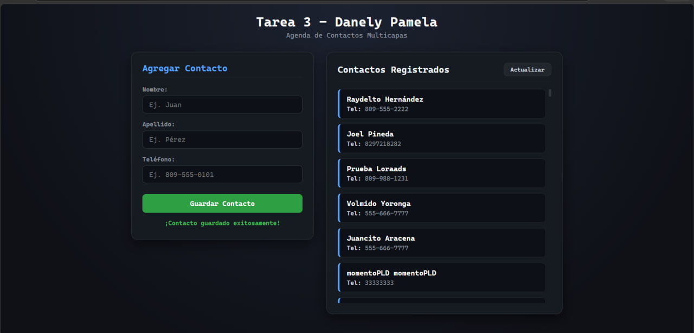

# Tarea 3: Agenda Multicapas

**Estudiante:** Danely Pamela Luis Pérez  
**Matrícula:** 2025-1214  
**Asignatura:** Programación Web  

---

## Descripción del Proyecto
Aplicación web cliente-servidor desarrollada para la gestión de contactos, conectada a una API REST externa mediante la función nativa `fetch`.

### Características implementadas:
* **Lectura de contactos (GET):** Consulta y renderizado dinámico de la lista de contactos en formato JSON desde el servicio remoto.
* **Registro de contactos (POST):** Formulario validado para enviar nuevos contactos (`nombre`, `apellido`, `telefono`) serializados en JSON hacia el servidor.

---

## Captura de Pantalla

